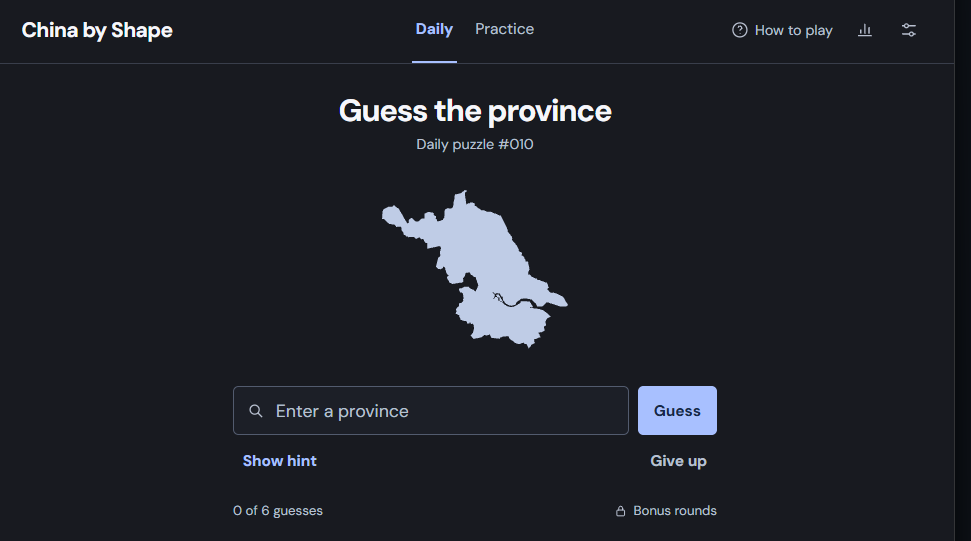

# Provincele

Provincele is a China geography game inspired by [Worldle](https://worldle.teuteuf.fr/). It includes 34 playable province-level geographies and a new daily puzzle at local midnight. Practice mode lets you play another outline at any time.



## Play locally

Open `dist/index.html` in a browser, or run this command from the repository root and visit [localhost:8000](http://localhost:8000/).

```sh
python3 -m http.server 8000 --directory dist
```

The game has no build step. Progress, statistics and settings are stored in the current browser.

## Rounds

You have six guesses to identify the outline. Each guess returns distance, direction and proximity. Finishing the outline unlocks the bonus rounds.

1. Neighbours
2. Capital name and map location
3. Orientation and straight-line distance
4. Flag identification with regional abbreviation banners
5. Geography, administrative and history trivia
6. Landmark photo and name
7. Emblem identification with Chinese capital-name seals
8. Spoken language and written-name matching
9. GDP per capita estimate and comparison
10. Population and currency
11. Population ranking for cities or comparable districts
12. Surface area comparison

The summary shows results, the time to the next daily puzzle and a spoiler-free share card.

## Data and credits

The game’s **Data & credits** panel links to the boundary, demographic, economic and historical sources. It also lists the Wikimedia Commons photo authors and licenses. The maps use generalized boundaries. The banners and seals are game artwork.
